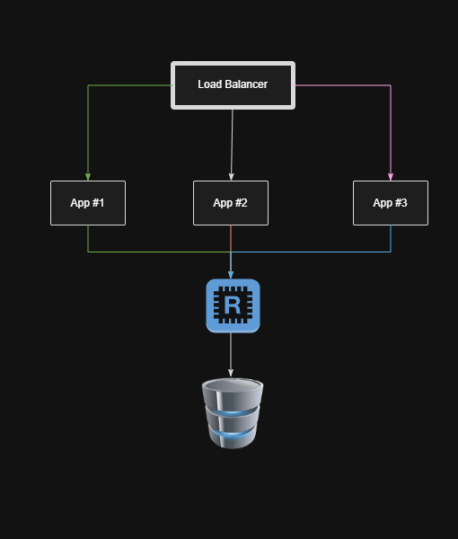
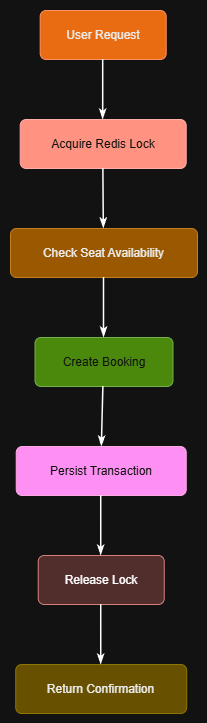

# GoSeats ~ Cinema Booking System 

A distributed cinema booking system built with Go and Redis that focuses on preventing double bookings under high concurrency.

---

# Cinema ticket booking system

Starter code for the gradual explanation on how to create a ticket booking system
to solve for the double booking system and provide a good UX for clients when booking
a ticket and avoid conflicts in a high contention enviroment.

## The Problem

Two users click "Book" on seat A1 at the same instant. Only one should win.

```bash
User A ──► read seat A1 → "free" ──► write booking ──► success
User B ──► read seat A1 → "free" ──► write booking ──► ???
```
Without any protection, both succeed. Now two people show up for the same seat.


# Functional Requirements

## Happy Path: User Booking

### Synchronous Approach
- User selects movie, showtime, and seats.
- Seat availability is checked immediately.
- Booking is created.
- Payment is processed.
- Confirmation is returned to the user.

### Async Approach
- Booking request is accepted.
- Request is placed into a queue.
- Background workers process bookings.
- User receives booking confirmation asynchronously.

### Movie-Specific Queues
- Separate queues per movie/showtime.
- Isolates traffic between screenings.
- Allows independent scaling for popular shows.

### Online Booking
- Browse movies and schedules.
- Select seats from an interactive seat map.
- Complete payment.
- Receive digital ticket confirmation.

---

# Preventing Double Bookings

## The Problem

Two users attempt to book the same seat at the same time.

```text
User A:
Read Seat A1 -> Free
Write Booking

User B:
Read Seat A1 -> Free
Write Booking
```

Without proper concurrency control, both operations may succeed, resulting in two bookings for the same seat.

---

# Concurrency Strategies

## Strategy 1: Pessimistic Locking

Lock the seat before performing any read or write operation.

```text
Acquire Lock
    ↓
Read Seat
    ↓
Check Availability
    ↓
Create Booking
    ↓
Release Lock
```

### Advantages

- Prevents double booking.
- Easy to reason about.
- Strong consistency guarantees.

### Drawbacks

- Reduced throughput under heavy traffic.
- Waiting requests may increase latency.

---

## Strategy 2: Optimistic Concurrency

Allow reads without locking and validate data during the write phase.

```text
Read Version 1
      ↓
Process Booking
      ↓
Attempt Update
      ↓
Version Changed?
   ├─ Yes → Fail / Retry
   └─ No  → Success
```

### Advantages

- Better throughput.
- Scales well when conflicts are rare.

### Drawbacks

- Requires retry logic.
- Increased failure rate during peak traffic.

---

# Why Pessimistic Locking?

Cinema booking systems naturally experience high contention:

- Popular releases
- Limited seat inventory
- Opening-night traffic
- Promotional sales

Since seat conflicts are expected, pessimistic locking provides a safer and simpler solution.

---

# Distributed Architecture

A local mutex works only in a single application instance.

When multiple servers are deployed, locking must be shared across all instances.

<!-- ```text
                +----------------+
                | Load Balancer  |
                +--------+-------+
                         |
        +----------------+----------------+
        |                |                |
        ▼                ▼                ▼
   +---------+      +---------+      +---------+
   | App #1  |      | App #2  |      | App #3  |
   +---------+      +---------+      +---------+
          \             |             /
           \            |            /
            +-----------+-----------+
                        |
                        ▼
                  +-----------+
                  |   Redis   |
                  +-----------+
                        |
                        ▼
                  +-----------+
                  | Database  |
                  +-----------+
``` -->



---

# Redis Distributed Lock

A distributed lock ensures that only one application instance can reserve a seat at a time.

```redis
SET seat:A1:lock unique-id NX PX 30000
```

If the command succeeds:

- Lock acquired
- Booking can proceed

If the command fails:

- Another process is already booking the seat
- Request must retry or fail

---

# Booking Flow

<!-- ```text
User Request
      ↓
Acquire Redis Lock
      ↓
Check Seat Availability
      ↓
Create Booking
      ↓
Persist Transaction
      ↓
Release Lock
      ↓
Return Confirmation
``` -->

---

# Core Guarantee

```text
One Seat
    +
One Lock
    =
One Successful Booking
```

No double bookings, even when multiple users attempt to reserve the same seat simultaneously across multiple application instances.


   